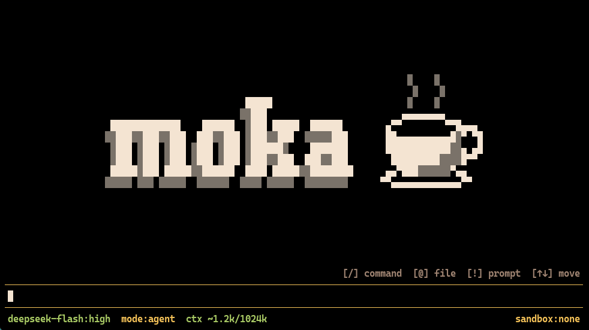

# moka

A minimal, opiniated, terminal ai harness made for local LLMs first.



## Why moka

- **Local AI first:** Minimal system prompt. Five tools. Nothing more, the harness does not expect frontier models.
- **Private:** Use local models, keep sessions and configuration on your
  machine. Opt into a cloud provider if you want one.
- **Sandboxing:** Start bubblewrap, podman, or docker
  from one picker; roles still control which tools can run.
- **Lightweight:** Four runtime dependencies, low CPU and memory use, and a
  single-command install with no daemon to manage.
- **Customizable:** Everything is plain TOML, in ~/.config/moka, and the bundled `!moka-config`
  prompt lets moka configure itself.
- **Linux-native:** Built for the terminal, not bolted onto an IDE.
- **No command filtering** Command filtering cannot be done reliably. The boundary belongs to the sandbox.

Small enough to stay out of the way. Flexible enough to make yours.

## Getting Started

New to moka ? 

The [getting started guide](docs/getting-started.md) walks from
install to your first file edit.

## Requirements

- Linux, Python 3.11+
- A model endpoint: llama.cpp, another OpenAI-compatible server, OpenRouter, or
  DeepSeek
- An editor (`$VISUAL` or `$EDITOR`) for `/config`, `/diff`, and file editing
- Optional: podman, docker, or bubblewrap for sandboxes
- Optional clipboard tools: `wl-paste` or `xclip` for image paste; `xclip`,
  `xsel`, or `wl-copy` for copying

## Installation

With [uv](https://docs.astral.sh/uv/):

```bash
uv tool install git+https://github.com/roackim/moka-code.git
```

or with [pipx](https://pipx.pypa.io):

```bash
pipx install git+https://github.com/roackim/moka-code.git
```

To update later: `uv tool upgrade moka-code` or `pipx upgrade moka-code`.

Then start moka from the project you want to work on:

```bash
cd my-project
moka
```

## First run

moka starts with no model configured. Open the server settings, uncomment one
of the examples, save, and pick a model:

```bash
/config servers
/model
```

For llama.cpp:

```toml
[servers.local]
type = "llamacpp"
base_url = "http://localhost:8080/v1"
```

For OpenRouter, export `OPENROUTER_API_KEY` before starting moka:

```toml
[servers.openrouter]
api_key = "$OPENROUTER_API_KEY"
models = ["deepseek/deepseek-v4.1-flash"]  # the ids /model should offer
```

For DeepSeek, export `DEEPSEEK_API_KEY`:

```toml
[servers.deepseek]
api_key = "$DEEPSEEK_API_KEY"
```

`$NAME` reads the `NAME` environment variable when moka starts. You can put the
key directly in the file instead, for example `api_key = "sk-..."`, but avoid
committing it.

An OpenAI-compatible server uses `type = "openai-compatible"` with a
`base_url`. See the commented examples in `servers.toml` for the details.

## Shell integration

`/terminal` opens a shell in the project while moka keeps running. Shells opened
by moka have `MOKA_TERMINAL` set; moka refuses to start inside one. To mark the
prompt with a colored `(moka)`, add this to your `~/.bashrc`:

```bash
[ -n "$MOKA_TERMINAL" ] && PS1="\[\e[38;5;173m\](moka)\[\e[0m\] $PS1"
```

or to your `~/.zshrc`:

```zsh
[[ -n $MOKA_TERMINAL ]] && PROMPT="%F{173}(moka)%f $PROMPT"
```

## Configuration

Configuration lives in `~/.config/moka/` (or `$MOKA_CONFIG_DIR`) and is created
on first run with commented examples. `/config` opens a picker; hand edits are
applied with `/reload`, while an editor opened by `/config` reloads when it
closes.

`state.toml` and `projects/` are written by moka. Leave them alone. Rest is pretty self explanatory.

## Documentation

The [user guide](docs/README.md) covers setup, providers, permissions,
configuration, sandboxes, and troubleshooting. Run `/help` inside moka for the
full command list.

If you want to contribute, see [CONTRIBUTING.md](CONTRIBUTING.md).

## License

Apache-2.0. See [LICENSE](LICENSE).
